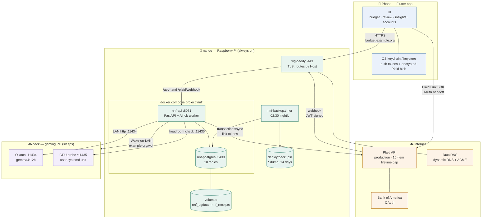
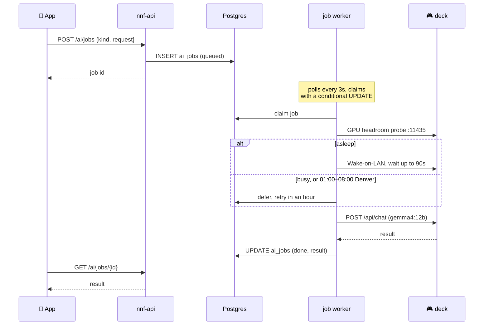
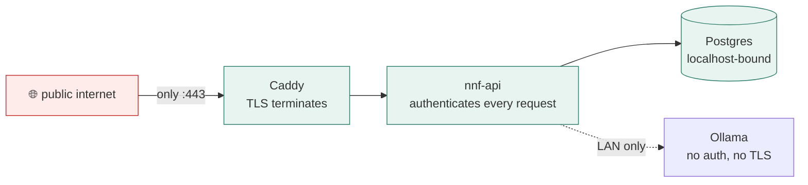
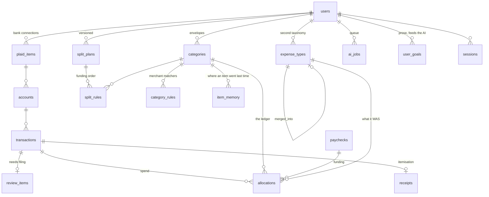
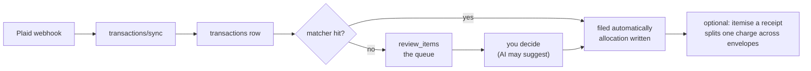

# 14 — System map

Every moving part, where it runs, and how the parts reach each other.
Written 2026-11-03 from the live systems — containers, systemd units
and the database were inspected rather than recalled, so this describes
what is actually running.

Schema: [`docs/schema/schema.sql`](schema/schema.sql), dumped from the
live database. Regenerate with `scripts/dump-schema.sh`.

## The four places code runs

| Where | What | Always on? |
|---|---|---|
| **Phone** (Pixel 9 Pro, Galaxy S21) | Flutter app, `org.nonsensefinance.nnf` | with you |
| **`nando`** — Raspberry Pi, Europe/London | FastAPI + Postgres in Docker, behind Caddy | yes |
| **`deck`** — gaming PC, SteamOS, America/Denver | Ollama (`gemma4:12b`) + a GPU probe | **no — sleeps** |
| **Plaid** | bank connections, OAuth, transaction feed | external |

The deck sleeping is a design constraint, not an accident: it is a
gaming PC that must not spin up at 3am. Everything AI is therefore a
*queued job*, never a blocking request.

## On the Pi

Two containers in the compose project `nnf`, plus one shared container
that predates this project.

| Container | Image | Exposed |
|---|---|---|
| `nnf-api` | built from `backend/Dockerfile` | `8081` — **not published to the host**, reachable only on the Docker network |
| `nnf-postgres` | `postgres:16-alpine` | `127.0.0.1:5433` — localhost only, so the VPN reaches it but the LAN does not |
| `wg-caddy` | shared with the WireGuard stack | `443` — the only port open to the world |

`nnf-api` joins two Docker networks: `nnf` (to reach Postgres) and the
external `wg` network (so Caddy can reach it). Caddy routes by `Host`
header, which is why this project got its own subdomain rather than a
path on the apex — `wg-easy` already owns `/api/*` there.

Also on the Pi, unrelated to this project but sharing the box:
`wg-easy`, `wg-duckdns`, `jellyfin`, `big-bear-portainer`.

### Storage on the Pi

| What | Where | Note |
|---|---|---|
| Database | docker volume `nnf_nnf_pgdata` | the only copy of your Plaid `access_token`s |
| Receipt images | docker volume `nnf_nnf_receipts` → `/data/receipts` | **provisioned but empty** — receipts are processed in memory today |
| Backups | bind mount `~/nnf/deploy/backups` → `/backups` | 5 dumps, 16 MB, 14-day retention |
| Secrets | `~/nnf/.env`, mode 600 | Plaid production secret, `TOKEN_ENCRYPTION_KEY`, WoL token |
| Caddy TLS | volumes `wireguard_caddy_{data,config}` | certificates |

### Scheduled work on the Pi

| Unit | When | Does |
|---|---|---|
| `nnf-backup.timer` | 02:30 Europe/London, `Persistent=true` | `deploy/backup.sh` — dumps, **restores into a scratch database and compares row counts**, prunes past 14 days |

There is **no cron** for this project — `crontab -l` is empty for both
`neil` and root. The nightly backup is the only scheduled job.

### Scripts on the Pi outside the containers

Two loose files in `~/nnf/` that are **not** in the repo and **not**
scheduled — one-offs kept after use:

- `gemma4_pull.sh` (+ `gemma4_pull.log`) — pulled `gemma4:12b` onto the
  deck driven from the Pi, so the download did not depend on the
  laptop staying connected. Wakes the deck if it sleeps mid-pull.
- `pull_jobs.py` — read back the stored request/result of receipt AI
  jobs while debugging extraction.

Neither runs on its own. They are listed here because "what runs
outside the containers" is otherwise invisible.

## On the deck

Nothing here is always-on, and nothing here holds state that matters.

| Service | Port | Installed by |
|---|---|---|
| Ollama | `11434` | SteamOS package, holds `gemma4:12b` |
| GPU headroom probe | `11435` | `deploy/deck/install.sh` — a **user-level** systemd unit |

The probe is a user unit deliberately: SteamOS replaces the 5 GB `/`
partition wholesale on a major update, but `/home` and `/var` persist,
so anything installed under `/home` survives. The probe exists because
Ollama's own `/api/ps` under-reports badly — it claimed 1411 MB for a
model actually using nearly 10 GB.

**The Pi reaches the deck directly over the LAN** (`http://192.168.86.196:11434`),
not through the internet. Waking it is the exception: that goes out to
the public Wake-on-LAN endpoint `example.org/wol`.

### Why AI work is queued, never direct

Quiet hours are pinned to **America/Denver**, not the server clock. The
Pi runs Europe/London, six hours ahead; "01:00–08:00" on the Pi's clock
would have blocked 19:00–02:00 where the PC actually is.

## On the phone

The app holds almost nothing. There is **no local database** — no
SQLite mirror, no offline cache. Every figure on screen came from the
API.

What is stored, in the OS keychain / Android keystore (never
`SharedPreferences`):

- access token, refresh token
- an **encrypted** copy of the Plaid token blob — ciphertext, useless
  without `TOKEN_ENCRYPTION_KEY`, which lives only on the Pi

This is why signing in on a second phone just works, and why updating
the APK loses nothing.

## Trust boundaries

- Port 443 is the only thing open to the world. Caddy answers a flat
  404 to anything that is not `/api/*` or `/plaid/webhook` — scanners
  were probing for `/wp-json/` within five seconds of the certificate
  appearing in Certificate Transparency logs.
- The Plaid webhook is public by necessity; the handler verifies
  Plaid's JWT signature before trusting anything in it.
- **Ollama has no authentication and no TLS.** That is acceptable only
  because it is never exposed beyond the LAN. Do not port-forward it.
- Plaid `access_token`s are encrypted at rest with a key held outside
  the database, so a stolen dump yields nothing usable.

## The data model

18 tables. Everything hangs off `users`, and nearly every foreign key
cascades on delete — removing a user removes their entire world.

### Two orthogonal taxonomies

A charge answers two separate questions, and conflating them is the
mistake this design exists to avoid (ADR 0008):

- **`categories`** — *which envelope paid for it.* Funding.
- **`expense_types`** — *what the thing actually was.* Reporting.

Lunch out of "Personal Discretionary" and lunch out of "Date Fund" are
different envelopes and the same expense type, which is how "how much
on fast food this month" is answerable across pots.

### `allocations` is the ledger, and it is append-only

Every movement of money is a row. Corrections are **opposing entries**,
never edits or deletes, so history always explains itself.

A row is funding or spending depending on what it points at:

| `paycheck_id` | `transaction_id` | Meaning |
|---|---|---|
| set | null | a paycheck funded this envelope |
| null | set | a charge was filed against this envelope |
| null | null | a transfer between envelopes |

That last distinction matters: **spend is a negative allocation
attached to a transaction.** Moving money between envelopes is not
spending, and analytics must not count it as such.

Two sign conventions coexist and exactly one place translates between
them — the review queue is budget-relative (positive = money left the
budget), the ledger is category-relative (positive = the envelope
gained). `Activity.budgetSignedCents` is that single point. Do not add
a second.

### Live row counts (2026-11-03)

| Table | Rows | | Table | Rows |
|---|---:|---|---|---:|
| users | 27 | | allocations | 158 |
| sessions | 120 | | paychecks | 16 |
| plaid_items | 6 | | review_items | 70 |
| accounts | 33 | | expense_types | 2 |
| transactions | 98 | | item_memory | 0 |
| categories | 124 | | receipts | 0 |
| category_rules | 15 | | ai_jobs | 109 |
| split_plans | 66 | | user_goals | 15 |
| split_rules | 449 | | alembic_version | 1 |

Most of those users are leftovers from testing. `receipts` and
`item_memory` are empty: both features work but neither has been used
against the real account yet.

Counted directly, not read from `pg_stat_user_tables` — those estimates
reset when a container restarts, and on the day this was written they
claimed 2 users and 3 plaid_items.

## How a transaction becomes a budgeted charge

Nothing files itself without either a deterministic matcher or your
explicit decision. The model may *suggest*, but ADR 0003 holds: the app
works fully with AI switched off.

## Single points of failure, honestly

1. **The Pi's disk.** The only copy of the database. Backups are
   nightly and verified, but they live on that same disk — there is no
   off-box copy yet.
2. **`TOKEN_ENCRYPTION_KEY`.** Backups restore ciphertext. Without the
   key, a restore gives back a budget and zero working bank
   connections, and relinking permanently spends one of ten Plaid
   credits.
3. **The 10-Item Plaid cap.** Lifetime, and `/item/remove` does not
   return a slot. This is why the backup script verifies itself by
   restoring rather than just writing a file.
